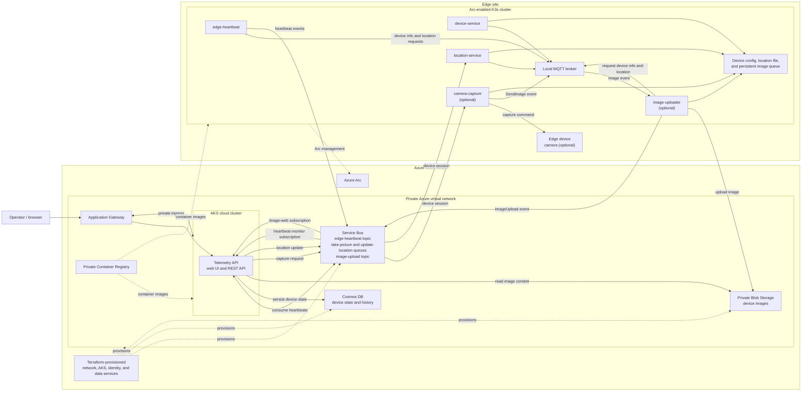

# tactical-arc-demo

Build out an application showing remote management of a device at the edge using Arc, and connecting to a the cloud for data and telemetry.

## Solution architecture



### Component descriptions

| Component | Responsibility |
| --- | --- |
| **Terraform infrastructure** | Provisions the Azure Government network, private AKS cluster, private registry and data services, managed identities, and the edge landing resource group. |
| **Application Gateway** | Provides the cloud application's ingress into AKS. |
| **AKS and Telemetry API** | Runs the cloud web UI and REST API. It consumes device events, maintains per-device state, and supports camera and location commands. |
| **Azure Arc** | Connects the edge Kubernetes cluster to Azure for management. The edge site's VPN provides private network connectivity to Azure resources. |
| **Service Bus** | Carries edge heartbeats, image-upload notifications, and session-targeted camera and location commands. |
| **Cosmos DB** | Stores one device document per device, including bounded heartbeat and image metadata histories and the latest location and device specifications. |
| **Private Blob Storage** | Holds uploaded image bytes; Cosmos DB stores their metadata. |
| **Private Container Registry** | Stores application images for cloud and edge deployments. Edge images can be replicated to a registry reachable by the device. |
| **Edge K3s workloads** | `edge-heartbeat` gathers device information and location over MQTT and publishes heartbeats. `device-service` and `location-service` serve local requests; location updates are persisted on the device. |
| **Local MQTT broker** | Routes correlated requests and responses among the edge workloads without sending local device traffic to the cloud. |
| **Optional camera pipeline** | `camera-capture` receives a device-targeted command, captures an image, and queues it locally. `image-uploader` enriches and uploads queued images, then notifies the cloud. The image pipeline is disabled by default. |
| **Edge device storage and hardware** | Host-mounted files preserve device configuration and location, while a persistent volume buffers images until upload succeeds. A V4L2-compatible camera is optional. |

## Repository layout

| Path | Purpose |
| --- | --- |
| `/infra` | Terraform templates for Azure Government, authenticated with the logged-in Azure CLI user. |
| `/cloud-cluster` | The apps to run the cloud cluster. |
| `/cloud-cluster/apps` | Containerized app source code and Dockerfiles. |
| `/cloud-cluster/helm` | Helm chart deploying the cloud apps and dependencies onto the cluster. |
| `/cloud-cluster/scripts` | Scripts for building and deploying the cloud section. |
| `/remote-cluster` | The apps designed to run at the edge. |
| `/remote-cluster/apps` | Containerized edge app source code and Dockerfiles. |
| `/remote-cluster/helm` | Helm chart for deploying the apps to the edge device. |
| `/remote-cluster/scripts` | Edge scripts, including Kubernetes/Docker stand-up for the edge cluster. |
| `/scripts` | General scripts for the repo. |

## Edge device bootstrap

For a full Raspberry Pi / Jetson Nano runbook — OS flashing, Kubernetes
(K3s), site-to-site VPN into the Azure VNet, Azure Container Registry
connectivity and image replication, Azure Arc, Service Bus, and the Helm
deploy — see
[`remote-cluster/docs/edge-device-bootstrap.md`](remote-cluster/docs/edge-device-bootstrap.md).

## Edge camera image flow

The optional image pipeline extends the heartbeat monitor without changing its
default deployment:

1. The cloud UI sends a GUID-correlated `TakePicture` command for the selected
   device through a session-enabled Service Bus queue. `camera-capture` receives
   only its device session, captures `/dev/video0`, and writes the JPEG plus a
   recovery manifest to the shared edge volume.
2. It publishes a QoS 1 `SendImage` event to the local Mosquitto router.
3. `image-uploader` uploads pending manifests to the private `device-images`
   blob container after obtaining current device metadata from `device-service`
   over a correlated local MQTT request. Connectivity is checked every five seconds; five failures
   open the circuit for one minute, followed by one-second half-open probes
   until connectivity returns.
4. After upload, it publishes `ImageUpload` to Service Bus and removes the
   local image and manifest.
5. The existing cloud heartbeat monitor consumes `ImageUpload`. Selecting a
   device can trigger a capture, inspect correlated request status in a
   collapsible panel, browse image tiles, and open the full image metadata.

Set `imagePipeline.enabled=true` in the remote chart and
`telemetryApi.imageServiceBus.enabled=true` in the cloud chart after applying
the Terraform resources. Both applications support connection strings for
local/demo use and `DefaultAzureCredential` with the private Terraform
deployment.

## Dev container

`.devcontainer/` provides a container with everything needed to work on this repo:

- **SSH git authentication** – the host `~/.ssh` directory is mounted (read-only) and copied
  into the container with correct permissions, GitHub host keys are trusted, and available
  keys are added to the SSH agent. VS Code also forwards the host `ssh-agent`.
- **kubectl** and **helm**
- **Azure CLI** (defaults to the `AzureUSGovernment` cloud via `AZURE_CLOUD`)
- **Terraform** (with tflint)
- **Packer** (installed from the HashiCorp apt repository in `post-create.sh`)
- Docker-in-Docker for building the container images

> The dev container mounts the host `~/.ssh` directory read-only, so create it on the
> host (with your git key) before starting the container.

Verify the tooling inside the container with:

```bash
./scripts/verify-tools.sh            # tool availability only
./scripts/verify-tools.sh --check-ssh # also test SSH auth against github.com
```

## Linting

```bash
./scripts/lint.sh
```
